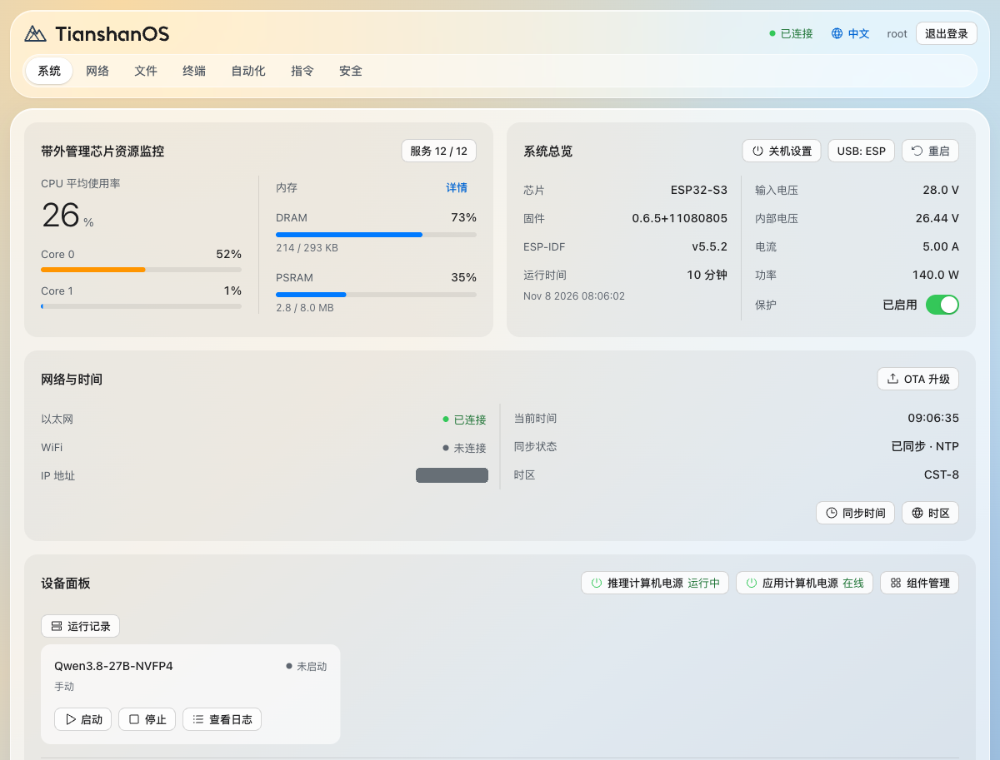
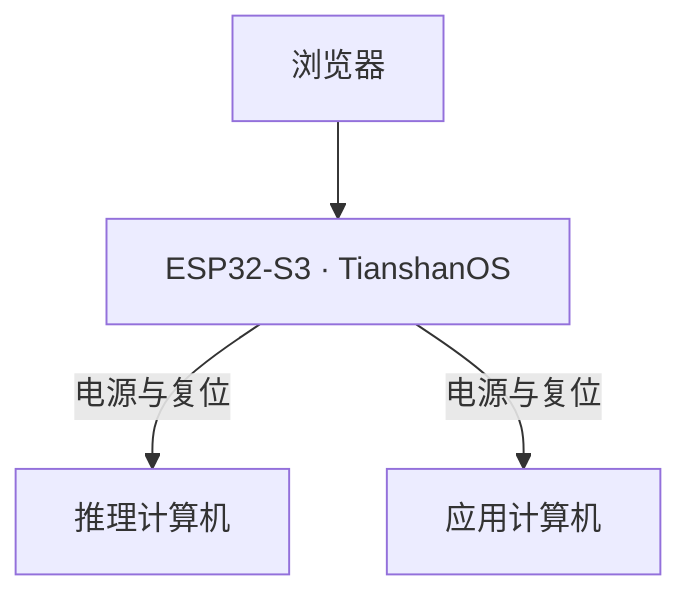

# TianshanOS · 天山OS

**RM-01 的开源带外管理系统**

推理计算机无响应，SSH 也连不上？只要 RM-01 的管理控制器仍有供电、管理网络仍可达，你就能打开浏览器查看电源状态，必要时从控制台或 API 执行硬件复位。平时，同一套系统也让你查看温度和功耗、管理风扇，并按自己的规则自动执行操作。

[用户指南](https://www.rminte.com/) · [下载固件](https://github.com/RMinte/TianshanOS/releases/latest) · [English](README_EN.md)



*RM-01 实机 Web 界面，已隐去内网地址。*

## 主机无响应时，你还能管理硬件

TianshanOS 运行在 RM-01 内独立的 ESP32-S3 控制器上。浏览器连接的是这颗控制器，它通过硬件信号控制推理计算机和应用计算机的电源与复位。即使主机系统没有响应，控制器仍可以发出这些信号。



这颗控制器也负责日常散热。风扇的智能模式以温度曲线为基础，参考升温趋势调整输出。温度数据失效时，风扇会按预设的调速值运行，页面会显示「温度失效」，方便你检查数据源。

## 设一条规则，让设备自己动手

假设你希望推理计算机温度过高时，站在机器旁就能看见告警，事后也能查到记录。可以在「自动化」里设一条规则。

1. **选数据。** 接入提供主机温度的 REST 或 WebSocket 数据源，选择要监测的温度字段。
2. **定条件。** 设定高温阈值，用规则的冷却时间限制重复告警的频率。
3. **加动作。** 让机身 LED 矩阵显示告警，同时写一条日志。

规则也能调用已配置的 SSH 指令。比如，给「启动推理服务」这条规则打开「显示在面板」和「允许手动触发」，就能从首页运行它，并查看运行记录。[了解自动化引擎](docs/AUTOMATION_ENGINE.md)

## 日常使用、备份和升级

把 RM-01 接入网络，在同一管理网络中用浏览器打开设备 IP，再用设备账号登录。首页集中显示供电、网络和散热状态，以及已配置的快捷操作。

- **日常操作用 admin，需要管理账号、网页终端或编辑自动化时用 root。** 配置 SSH 主机时核对主机指纹，确认连接的是预期设备。[账号、SSH 与证书指南](docs/guides/security/guide.zh.md)
- **给自动化留一份应急副本。** 可以把 SD 卡上的规则、数据源和 SSH 配置保存到控制器内部。SD 卡不可用时，系统可以使用有效的内部配置。卡上的图片、字体和日志需要另行备份。[配置保存与恢复](docs/AUTOMATION_STORAGE.md)
- **升级前先备份，并按当前分区布局选择升级方式。** 固件与 Web 界面资源请使用同一 Release 的配套文件。旧分区布局的设备按发布说明使用 USB／串口升级包。[固件下载与升级说明](https://github.com/RMinte/TianshanOS/releases/latest)

## 给开发者，从一次状态查询读懂框架

TianshanOS 也是一套配置驱动的嵌入式框架。RM-01 的板级目录集中描述引脚、设备和服务，硬件操作由独立的驱动实现。想顺着代码看一遍，可以从查询推理计算机的状态开始。

- **查什么。** Web 界面读取推理计算机的状态。你也可以在串口输入 `device --agx --status`。两者调用同一个 `device.status` 处理函数。[串口命令](components/ts_console/commands/ts_cmd_device.c) · [API 实现](components/ts_api/src/ts_api_device.c)
- **怎么取到。** 处理函数向设备控制驱动读取状态。要看 RM-01 如何定义逻辑设备，以及电源和复位信号如何对应引脚，可以从板级目录里的 `devices.json` 和 `pins.json` 开始。[设备控制驱动](components/ts_drivers/src/ts_device_ctrl.c) · [RM-01 板级配置](boards/rm01_esp32s3/)

源码构建使用与 CI 一致的 **ESP-IDF v5.5.2** 和 **ESP32-S3** 目标。启用 ESP-IDF 环境后即可构建：

```bash
git clone https://github.com/RMinte/TianshanOS.git
cd TianshanOS
idf.py -B build/local set-target esp32s3
idf.py -B build/local build
```

[API 参考](docs/API_REFERENCE.md) · [架构设计](docs/ARCHITECTURE_DESIGN.md) · [运行时回归测试](tests/runtime/README.md) · [CI 构建流程](.github/workflows/build.yml)

## 许可证

TianshanOS 采用 [GPL-3.0 许可证](LICENSE)。
