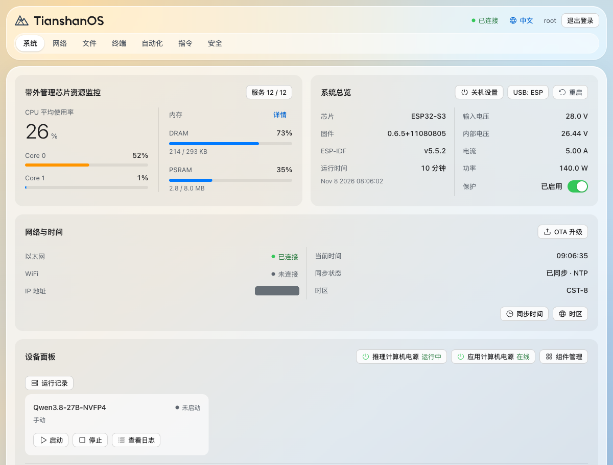
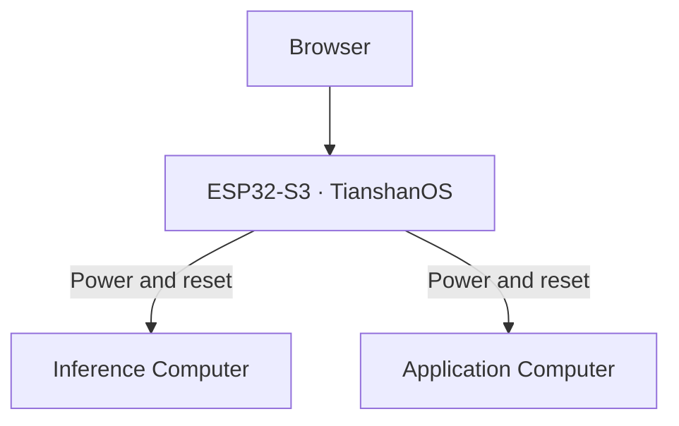

# TianshanOS

**Open-source out-of-band management for RM-01**

If the Inference Computer freezes and SSH stops responding, you can still check its power status in your browser as long as the RM-01 management controller has power and is reachable. If you need a hardware reset, use the serial console or the API. Day to day, the same system lets you monitor temperature and power draw, manage cooling, and automate routine tasks.

[User guides](https://www.rminte.com/) · [Firmware downloads](https://github.com/RMinte/TianshanOS/releases/latest) · [简体中文](README.md)



*Dashboard captured on an RM-01, shown in Chinese with the local IP address hidden. The web interface is available in English and Chinese.*

## Manage the hardware when a host stops responding

TianshanOS runs on a dedicated ESP32-S3 inside RM-01. Your browser connects to that controller, which can send power and reset signals to both the Inference Computer and the Application Computer even when a host OS stops responding.



The controller also handles cooling. In Smart mode, it adjusts fan output based on the configured temperature curve and how quickly the temperature is rising. If the temperature readings go stale, it switches to a preset fan setting and flags the problem on the dashboard so you can check the data source.

## Turn a temperature reading into an alert

Suppose you want a warning you can see on the machine itself and look up later. Set up a rule on the **Automation** page:

1. **Choose a data source.** Use a REST or WebSocket feed that reports the Inference Computer's temperature and select the field to watch.
2. **Set a threshold.** Trigger the rule when the temperature exceeds your limit. Add a cooldown to control how often the alert can repeat.
3. **Add actions.** Display a warning on the built-in LED matrix and write an entry to the system log.

Rules can also run saved SSH commands. For example, create a rule called “Start inference service” and turn on **Show on panel** and **Allow manual trigger**. You can then run it from the dashboard and check its run history. [Automation engine documentation (Chinese)](docs/AUTOMATION_ENGINE.md)

## Get connected, back up, and update

Connect your RM-01 to the network. From a device on that same management network, enter the RM-01's IP address in a browser and sign in. The dashboard shows power, network, and cooling status alongside any quick actions you've set up.

- **Use `admin` for everyday tasks and `root` for account management, the browser terminal, or editing automation rules.** When adding an SSH host, verify its fingerprint to confirm you're connecting to the intended machine. [Accounts, SSH, and certificates](docs/guides/security/guide.en.md)
- **Keep a recovery copy of your automation setup.** Save a copy of your SD card's rules, data sources, and SSH settings to the controller's internal storage. If the card is unavailable, TianshanOS can use a valid internal copy. Back up images, fonts, and logs from the SD card separately. [Configuration backup and recovery (Chinese)](docs/AUTOMATION_STORAGE.md)
- **Back up before updating and check your partition layout.** Use the firmware and web UI image from the same release. If your device still uses the older layout, follow the release notes for the USB serial upgrade package. [Firmware downloads and upgrade notes](https://github.com/RMinte/TianshanOS/releases/latest)

## Explore the framework through a status check

TianshanOS is also a configuration-driven embedded framework. The RM-01 board directory describes pins, devices, and services, while dedicated drivers handle hardware operations. A status check gives you a short path through the code:

1. **Start at the interface.** The dashboard calls `device.status` to check the Inference Computer. Run `device --agx --status` at the serial console to reach the same handler. [Console command](components/ts_console/commands/ts_cmd_device.c) · [API implementation](components/ts_api/src/ts_api_device.c)
2. **Follow it to the hardware.** The handler reads the status from the device control driver. Open `devices.json` and `pins.json` in the board directory to see how RM-01 describes its devices and maps their power and reset signals to pins. [Device control driver](components/ts_drivers/src/ts_device_ctrl.c) · [RM-01 board configuration](boards/rm01_esp32s3/)

To build from source, activate **ESP-IDF v5.5.2**. The version and the **ESP32-S3** target match the CI build.

```bash
git clone https://github.com/RMinte/TianshanOS.git
cd TianshanOS
idf.py -B build/local set-target esp32s3
idf.py -B build/local build
```

[API reference (Chinese)](docs/API_REFERENCE.md) · [Architecture (Chinese)](docs/ARCHITECTURE_DESIGN.md) · [Runtime regression tests](tests/runtime/README.md) · [CI build workflow](.github/workflows/build.yml)

## License

TianshanOS is licensed under [GPL-3.0](LICENSE).
